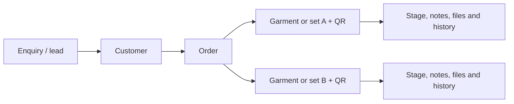

# DARZI — public website and operations UI plan

Prepared 8 October 2026; revised to incorporate the complete-rebuild and AI assembly-film requirements. This is an overview design specification, not an implementation or delivery commitment. Invoice preparation is excluded.

## 1. Product direction and research

Build an entirely new DARZI website and operations platform from scratch, replacing the current website/Squarespace setup and Trello workflow. The existing tools and competitor websites establish business context and creative references. The new experience gets its own architecture, layouts, components and motion direction.

The public website should make a striking first impression, earn trust and turn interest into consultation enquiries. The operations workspace should make customer intake and Australia–India production tracking fast and reliable. Both should feel purpose-built for DARZI.

The website serves prospective Melbourne tailoring clients, wedding parties and returning clients exploring another commission. The admin serves Australia customer-service staff, India production staff and the business owner. These audiences share a brand identity but need different layouts and interactions.

### What the references contribute

| Reference reviewed | Useful lesson for DARZI |
| --- | --- |
| [DARZI bespoke](https://darzi.com.au/bespoke/) and its live homepage/contact page | Learn the current positioning, services and contact journey. Rebuild the pages and enquiry handling; retain approved brand assets and useful URL continuity. The current contact form prepares an email rather than saving an enquiry. |
| [Gieves & Hawkes](https://www.gievesandhawkes.com/) and [bespoke tailoring](https://www.gievesandhawkes.com/pages/bespoke-tailoring) | Strong campaign imagery, clear explanations of tailoring services and repeated consultation actions. Adapt the education and visual confidence. |
| [Atlas Bespoke](https://atlas-bespoke.com/) and [bespoke tailoring](https://atlas-bespoke.com/pages/bespoke-tailoring-nyc) | Compact navigation, close-up garment photography and clean editorial presentation. Give finished work and material details space. |
| [Huntsman](https://www.huntsmansavilerow.com/) and [its process](https://www.huntsmansavilerow.com/pages/our-process) | Craft storytelling and fitting education help visitors understand what they are commissioning. Keep DARZI's navigation substantially smaller. |
| [Huntsman's eight-step video](https://www.youtube.com/watch?v=cRh4rF4OrbA) | Its chapters and transcript cover consultation, measurements, pattern drafting, cutting, handwork, first fitting, second fitting and final fitting. Use it as a storytelling reference, not as DARZI's operational workflow or reusable footage. |

All seven unique supplied URLs were opened or attempted. Both Trello invitations reached sign-in/join screens; board contents were unavailable. The operational stages below come from the attached screenshots and brief. The six screenshots contain three distinct images, each repeated.

Live browser pages differed from the search crawler's older DARZI snapshots. They supply context, not a design baseline for the rebuild. The live site publishes 9 Argon Circuit, Clyde North VIC 3978; 0412 141 222; and admin@darzi.com.au. Reconfirm these details with the client before launch. Do not carry forward unverified pricing, turnaround times, mill relationships, service promises or team biographies.

Replacement is a phased operational cutover: phase one replaces the website and Trello through the new public site, intake and production workspace; phase two adds the booking/financial functions in the original brief. The user names Squarespace as the website platform to replace. The earlier brief separately names Square as a feature reference for booking/calls; these names do not establish identical product scope.

## 2. Visual direction

### Public website: a contemporary tailoring house

The central impression should be a complete suit coming together with exceptional material detail. Follow that opening with generous photography, deliberate typography, short useful copy and a small navigation. Apply the approved DARZI mark and wordmark within a freshly designed visual system.

| Token | Choice and use |
| --- | --- |
| Midnight wool | `#17262B` — dark hero, navigation and selected editorial sections |
| Tailor's paper | `#F6F7F4` — light sections, forms and admin canvas |
| Ink | `#252B2A` — readable text on light surfaces |
| Wool grey | `#B2B9B5` — quiet borders and supporting surfaces; not small text |
| Brushed brass | `#A68B61` — restrained lines, selected details and highlights; not body text |
| Display type | Bodoni Moda, used for public headings with generous size and restrained italics |
| Body and interface type | Source Sans 3, used for paragraphs, forms, navigation and the entire working admin UI |
| Utility type | IBM Plex Mono, used sparingly for order IDs, fabric references and QR labels |

### Signature hero: the suit comes together

Create an original AI-assisted **14-second cinematic suit-assembly film**. One charcoal-wool two-piece suit remains visually consistent as its parts join: trousers, jacket structure, wool panels, lining, sleeves, lapels and buttons. This is the centrepiece of the homepage and its first impression.

Art direction: a dark, spacious atelier setting; soft directional light; a slow camera push; rich wool texture and subtle warm highlights. Cloth bends, drapes and settles with believable weight. The assembly has the precision of the engine/car references, expressed through tailoring materials. Keep the frame focused on the suit, with no extra shirts, watches or other props competing for attention.

| Film timing | Assembly beat |
| --- | --- |
| **0–2 seconds** | A legible exploded suit silhouette: cut wool panels, canvas, lining, trouser pieces and a few buttons arranged in atelier light. The opening frame is already visually complete enough to stand alone as a poster. |
| **2–4.5 seconds** | Trouser panels align; waistband, seams and crease settle into the finished shape. |
| **4.5–7.5 seconds** | The chest structure takes shape; jacket wool panels come together and the lapels roll naturally. |
| **7.5–10 seconds** | Lining settles inside and sleeves join the shoulders; restrained stitch/basting details suggest the joining of pieces. |
| **10–12 seconds** | Buttons, cuffs, pockets, collar and shoulders resolve with crisp tailoring detail. |
| **12–14 seconds** | The full jacket and trousers hold together in the light; one small cloth-settling movement finishes on a strong final frame. |

Production workflow: establish one approved suit design and anchor frames → generate controlled assembly segments with that same silhouette/material palette → edit/composite them into the continuous film → inspect garment continuity frame by frame → colour-grade and export responsive assets. Allow finishing work for seams, changing geometry and transitions rather than treating the first raw generation as final. The film presents the assembly concept; real approved finished-work and craft imagery below establishes the business's actual work.

**Desktop:** a 16:9 landscape master, with the suit roughly in the right-hand 60–70% of the frame and quiet dark space on the left for the headline. The full suit must remain visible across common laptop and wide desktop viewports. Suggested headline: **Every detail. Made around you.** Primary action: **Request a consultation**; secondary action: **Explore our work**.

**Mobile:** a separately composed 9:16 film using the same suit, lighting and assembly beats, with smaller lateral movement. Keep the entire suit in frame, clear space for a short heading, and the primary CTA visible in the opening viewport. Use the viewport's stable height for the hero and move supporting copy below it. The desktop landscape crop is not the mobile asset.

Latest user direction supersedes ordinary playback: the hero fills one stable viewport, with transparent centered navigation directly over the scene and no header divider. Native scrolling scrubs a pinned assembly sequence forwards and backwards, from pattern pieces through canvas, wool, lapels, lining, sleeves and finishing to the complete suit. There are no play, pause or replay controls. The wordmark, headings and consultation action remain live HTML. A sharp poster appears immediately; reduced-motion, data-saving and failed-load paths show the complete-suit still with usable navigation and actions. Original, matching AI keyframes currently drive the canvas sequence; this is a keyframe dissolve study, not a completed continuous HeyGen film. Competitor footage remains reference material.

### Homepage scroll choreography

Build one cohesive sequence with visual pacing, rather than adding the same reveal to every block. Use a 12-column desktop grid, a content width around 1280px and generous section spacing. Keep meaningful captions beside large image-led compositions.

| Section | Desktop motion | Mobile treatment |
| --- | --- | --- |
| **Assembly hero** | One full-screen pinned scene, with native scroll driving the construction frames over approximately 3.6 viewport-heights. Typography gives way to short assembly chapters; the finished suit leads into the next section. | One opening viewport, compact lower-scene framing and immediate CTA. Scroll drives the sequence; reduced motion remains a normal static section. |
| **Material / brand statement** | A wool-detail close-up and a short typographic statement introduce the tactile world behind the film. | Stacked image and text with a short opacity/position reveal. |
| **Selected work** | Asymmetric garment compositions enter in a controlled stagger; hover reveals a useful caption/action. | Vertical editorial cards with visible captions and tap actions. |
| **From pattern to presence** | One sticky image stage paired with four client-relevant chapters: consultation, design/pattern, fitting, finished garment. Images and a subtle chalk trace change with chapter progress over about two viewport-heights of scroll. | The same chapters appear as ordinary stacked content with light reveals. |
| **Services** | Distinct service compositions connect into the relevant page; a restrained image transition provides continuity. | Clear stacked service links with concise explanations. |
| **Fabrics** | Close-up textile imagery and a horizontally browsable fabric strip. | Native swipeable strip with an accessible button/list alternative. |
| **Testimonials and studio** | Settle into quieter proof and contact sections so the final consultation action is easy to find. | Readable proof, directions and contact action, without overlapping overlays. |

Use [GSAP ScrollTrigger](https://gsap.com/docs/v3/Plugins/ScrollTrigger/) for section/chapter choreography. Keep native scrolling, a full-screen hero assembly sequence and one desktop sticky craft story; animate children within each using transforms and opacity. The hero has no playback controls: scroll progress drives matching canvas frames. A later continuous film must also map frames to scroll rather than autoplay. All content remains visible and navigable if the motion layer is unavailable.

Use responsive and reduced-motion setups through [GSAP matchMedia](https://gsap.com/docs/v3/GSAP/gsap.matchMedia()/). Below 768px, remove story pinning and heavy parallax; retain short section reveals. Reduced motion exposes static content directly. Clean up animations on navigation and recalculate story positions after relevant image/font layout changes.

### Media delivery and performance targets

Export a 1080p desktop variant and a 720px-wide mobile variant at 24fps, with WebM and MP4 delivery, appropriate posters and reserved media dimensions. Target at most 5MB for the desktop film, 2.5MB for mobile and 150KB for each poster; validate these design budgets against the encoded sample and visible textile quality. Download only the chosen viewport variant and keep the poster/text ready while media loads. Lazy-load below-fold media; use self-hosted delivery and caching rather than a third-party hero player. [Video delivery guidance](https://web.dev/articles/video-and-source-tags), [loading guidance](https://web.dev/articles/lazy-loading-video).

Target LCP ≤2.5 seconds, CLS ≤0.1 and INP ≤200ms at the 75th percentile, segmented by mobile/desktop after sufficient real traffic exists. Before launch, use throttled lab loading checks plus real-device scroll, tap and playback tests; a lab score is not a field measurement. [Core Web Vitals guidance](https://web.dev/articles/vitals).

### Admin: a calm working interface

Use a predominantly light canvas, dark sidebar and compact Source Sans 3 typography. The brand's serif belongs only in a restrained welcome/header treatment. Operational content needs readable tables, labelled controls and predictable positions.

Desktop: persistent sidebar, top search, primary action, then board/table content. Order detail uses a main working area and a narrow summary panel. Intake uses grouped sections with a sticky completion summary. Mobile production screens show only the item and its immediate actions, with a large bottom action button. Keep primary controls at least 44px tall.

Use labelled status chips: neutral for active work, green for approved/ready, amber for attention and red for blocked/overdue. Colour never carries meaning alone. Board cards show item ID, garment, stage, due date, priority and a small thumbnail; large paper-form photos open inside the detail view. Avoid an oversized floating call panel on the public site: use a compact call action or mobile contact bar that does not cover content.

## 3. Complete public sitemap and page experience

Header: **Services** dropdown → Bespoke / Made to measure / Alterations; **Weddings**, **Our work**, **Our craft**, and **Request a consultation**. The logo returns home. Fabrics, The house and policy links sit in the footer and relevant page sections. Contact is also available in the footer and mobile menu.

| Page / template | Content and primary interaction |
| --- | --- |
| **Home** `/` | AI suit-assembly hero → material/brand statement → selected garments → process story → services → fabrics teaser → verified client testimonials → studio/contact section. Primary action: Request a consultation. |
| **Bespoke** `/bespoke/` | Explain the individual commission, personal pattern and fittings; show verified garment examples and choices. Include client-relevant process, FAQ and enquiry CTA. |
| **Made to measure** `/made-to-measure/` | Explain the service and how it differs from bespoke; show appropriate garments, customisation choices and fitting expectations. Use approved timing/prices only. |
| **Alterations** `/alterations/` | Types of work offered, examples, assessment process and FAQs. Invite the visitor to discuss the garment and request an assessment. |
| **Weddings** `/weddings/` | Groom and wedding-party stories, occasion garments, coordination, fittings and deadline guidance. Enquiry carries the wedding date and party size when supplied. |
| **Our craft** `/our-craft/` | The business story, verified team profiles, workmanship and an honest Melbourne consultation/India workshop explanation. Divide story, process and people into navigable sections. |
| **Fabrics** `/fabrics/` | Curated fabric families and approved mill information, close-up swatches, occasion/season guidance and a consultation action. A representative selection rather than every fabric SKU. |
| **Our work** `/our-work/` | A curated gallery of approved completed work, filterable by verified categories such as suits, weddings and occasionwear. Support relevant garment types shown in the business's work without assuming a menswear-only catalogue. |
| **Work story** `/our-work/[slug]/` | One reusable detail template: finished garment, brief, cloth/details, photographs and approved testimonial where available. Action: Discuss a similar commission. |
| **The house / World of Darzi** `/world-of-darzi/` | A newly designed secondary page for approved studio, culture and brand material. Its content must support the new experience; keep grooming/lifestyle booking flows outside the confirmed tailoring scope. |
| **Contact / consultation** `/contact-us/` | Short enquiry form, studio address, directions, appointment information, phone and email. No separate locations page is needed for one studio. |
| **Policies** | Preserve Privacy, Terms, and Cancellation & Refunds destinations. Use client-approved content relevant to the services; include applicable cookie information within Privacy. |
| **Utility states** | Enquiry acknowledgement, form failure/retry, gallery empty filter, missing work story and 404. These are designed states rather than navigation items. |

Keep FAQs within service/contact pages. Do not add a blog, store, basket, customer login, suit configurator or exhaustive materials catalogue to phase one. Retain useful URLs or implement deliberate redirects for search/link continuity; map `/wardrobe/` to the relevant everyday-work/service destination if its approved content is consolidated. Every included page is rebuilt with the new design system.

### Consultation journey

Visitor explores a garment or service → opens the shared enquiry page with that interest preselected → enters name, preferred contact details, desired service, optional occasion/date and message → sends request → sees **Enquiry received. We'll contact you to arrange your consultation.**

Save a successful enquiry into the admin Leads queue. Require a name, one reachable contact channel and the service/intent. Phone or email can satisfy the contact requirement. Optional contact preference, occasion date and wedding-party size support follow-up. Retain entries after validation/network errors and prevent duplicate submissions. A submitted enquiry does not reserve an appointment.

Public gallery images and testimonials must be specifically approved for publication. Admin fittings, measurement sheets, job forms and production photos never automatically appear on the website. Curated website content is maintained in the project for v1; a CMS is not implied by the operations admin.

## 4. Complete admin sitemap and workflows

Sidebar: **Overview**, **Leads**, **Orders**, **Production**, **Customers**, **Scan**. A persistent **New intake** action starts intake. **Team & settings** is available to the Super Admin. Account/session controls live in the profile menu.

| Screen / route | Purpose and layout |
| --- | --- |
| **Sign in and account recovery** `/admin/sign-in` | Email/password, recovery, expired-session and access-denied states. Login after a QR scan returns to that same item. |
| **Overview** `/admin` | Due soon, overdue, on hold, awaiting India acceptance, trial-ready and pickup-ready queues. Every count opens the corresponding filtered items. No revenue or attendance widgets in v1. |
| **Leads** `/admin/leads` | Public enquiries and manually entered prospects. Show source, requested service, event date, contact information and follow-up note. Convert into intake without re-entering customer details. |
| **New intake / draft** `/admin/intake` | Customer → garments/specification → measurements/references → dates/review. Save draft or Send to India; preserve progress when staff leave and return. |
| **Orders** `/admin/orders` | Searchable order table with customer, item count, aggregate progress, due/event dates, priority and hold indicators. Filters for team, stage, deadline, customer and Legacy archive. |
| **Production** `/admin/production` | Australia/India board views of shared items, plus a table alternative. Team selection and filters stay visible. Clicking a card opens item detail; a stage change uses the same action form as the scanner. |
| **Order detail** `/admin/orders/[id]` | Customer/order summary; item list with separate progress; specifications and measurement sources; notes, attachments, shipment records and chronological activity. Group related information into clear tabs. Historical imported records use a clearly labelled read-only legacy detail view. |
| **Item detail / scan result** `/admin/items/[id]` | A richer desktop detail view and a focused mobile action view of the same item. Show current stage, deadline, authoritative specification and the next action. |
| **Customers and customer detail** `/admin/customers` | Find returning clients, see previous orders and reuse a measurement source deliberately. Each order keeps its own measurement snapshot/history. |
| **Scan** `/admin/scan` | Camera scan, manual item-ID search, camera-permission/unavailable state and Scan next. Ordinary phone-camera QR links work too. |
| **Team & settings** `/admin/settings` | Super Admin invites/disables staff, assigns existing access presets and maintains basic business/QR printing settings. No configurable workflow builder in v1. |
| **Print job labels** | Print preview/action from intake or order detail, not a separate main navigation area. QR plus readable order/item ID and garment name; reprinting preserves the same item identity. |

### Fast intake

Use customer search first to avoid duplicate records. For a new customer, collect name and contact details. Add one or more independently tracked garments/sets with type, quantity, fabric reference, design choices, reference images and notes. Dates include required completion, event date and estimated arrival when known; they remain distinct fields.

Staff can attach the existing intake/measurement sheet as the authoritative v1 source, with a visible version/date. Optional named numeric measurements must show their unit and must not silently supersede the sheet. Do not invent the final measurement template from blurry screenshots. Replacing a source preserves its earlier version; reusing a customer's measurements does not rewrite earlier orders.

Repeat garments can be duplicated within intake. Use sensible defaults, keyboard navigation and a sticky Save draft / Send to India action. Missing information appears beside the relevant section. Dispatch requires a customer, item specification, measurement source where needed and the agreed production deadline; incomplete work remains a draft. Changes to measurements/specifications after dispatch are submitted as a new revision and visibly flagged Needs review for India. Show the previous accepted version alongside the pending revision; affected work cannot advance until the revision is accepted.

Saving creates a shared order and item IDs, with a QR label for each independently progressing garment/set. India can print the same label on acceptance, attach it to the job pack/material bag initially, then keep it with the article during manufacture. A suit set may share a label if its pieces always progress together; separate shirts or independently handled items get separate labels. Quantity never collapses independently handled garments into one identity: three separately progressing shirts produce three item IDs and labels.

### Production model and stages

Shared record structure:

**India board, grounded in the screenshots:**

Received from Australia → Review / Accepted → Procurement → Outside work, when needed → Cutting → Stitching → QC → Ready to ship → Shipping.

**Australia board, grounded in the screenshots with clearer handoff visibility:**

New order / To send to India → In production in India → In transit to Australia → Received in Australia → Trial ready → Alterations, when needed → Pickup ready → Completed.

Leads remain in the Leads screen. Australia's production and transit columns are derived from the item's India progress/shipment; they are not a second independently editable production status. Both teams work on shared records. Receiving specifications in India and physically receiving finished garments in Australia are separate events.

On hold is an exception visible across both boards, with reason, responsible person and underlying stage retained. Resolving the issue resumes work without losing history. Outside work is optional. A QC failure records the reason and routes rework to the appropriate earlier stage. Australia alterations explicitly record local work or a return to India; a return retains the order/item identity and opens another production/shipment cycle.

Allow items to finish and ship separately. An order shows progress such as **2 of 3 items ready**, and completes only when every required item is handed over. Support multiple shipment records, each linked to the items it carries. Administrative corrections/reopening require a reason and remain visible in activity.

### QR worker journey

**Scan → authenticate if needed → identify item → complete stage action → save → Scan next.**

The QR contains an opaque item link, not client data or permission to edit. Keep the signed-in session so staff do not enter credentials on every scan. On the item screen show a thumbnail/description, readable ID, current stage and deadline above one prominent next action.

Ordinary transitions need one confirmation action, with optional note/photo. Show additional fields only where useful: a hold/rework reason, QC pass/fail, shipment carrier/tracking/arrival estimate, or pickup confirmation. Stage-specific custom forms remain a later enhancement unless existing authoritative forms are provided.

Confirm the new stage only after the save succeeds. Duplicate taps/scans cannot create duplicate transitions. If another staff member changes the item meanwhile, refresh the stage and ask the worker to review the current action. Network failures leave an explicitly unsaved state and a retry action; v1 does not promise offline synchronisation. Manual search and label reprinting remain available.

### Permissions

Keep the two requested roles: **Super Admin** and **Admin**. Use fixed Australia customer-service and India production access presets beneath Admin, with explicitly granted cross-team visibility when needed.

Super Admin sees all records and manages users/settings/corrections. Australia admins manage leads, customer contacts, intake, fittings and pickup. India production admins access assigned production specifications, measurements, files and stage actions, without customer contact details by default. Team access is enforced on records and actions, including direct QR links; hiding navigation alone is insufficient.

## 5. Delivery boundaries and acceptance

### Phase one

The newly built public pages and AI-assisted hero film, consultation enquiries/Leads, rapid intake, shared orders/items, Australia/India tracking, QR printing/scanning, attachments, activity history and the minimal access controls above. Include migration and cutover so the website and Trello can actually be replaced.

### Replacement and cutover

- **Active Trello work:** migrate every open lead/order from both boards into live records, with its current stage, deadlines, measurement sources, specifications, comments and attachments. Reconcile Australia/India representations using verified source relationships; customer name alone is insufficient for merging orders. Resolve ambiguous mappings in migration review.
- **Historical work:** preserve accessible completed cards, historical activity/comments and files in a read-only Legacy archive reachable through existing Orders search/detail. Retain source IDs, authors and timestamps as legacy information, without manufacturing native production events.
- **Files and labels:** copy accessible attachments into the new platform's durable storage so staff can view them independently of Trello. Issue new item labels for active work and verify printing/scanning before switching production.
- **Website/Squarespace:** migrate approved content/assets, rebuild every included page and form, preserve the domain and retain or redirect important URLs. Host the new experience independently; enquiries save directly into the new admin.
- **Cutover:** rehearse imports, reconcile active-record counts, sample history/files and test both teams' complete journeys. At the agreed switch, stop legacy edits, import final changes and direct both teams to the new workspace. Retire each legacy platform after its replacement passes acceptance; verify data/domain recovery arrangements before cancelling services. This is a one-time migration, not an ongoing Trello integration.

Exports, board access, file availability and domain/hosting access are required migration inputs. Migration completeness is measured against the actual accessible source data; missing source data must be reconciled before claiming full retirement.

### Phase two

Appointment/call scheduling, booking emails/reminders, attendance, revenue reporting, Stripe payments and business invoicing. Replace any corresponding legacy operational functions when these are ready, completing the phased transition to the new platform. Design these when their workflows are confirmed; do not add inactive sidebar entries or speculative screens now. Fabric inventory, a vendor portal, customer tracking portal, CMS and a custom stage/form builder are separate potential scope additions, not assumed phase-two commitments.

The attached brief mentions 15 October 2026 for phase one and 1 November 2026 for phase two. Treat these as requested targets. A firm schedule needs the final content, measurement forms, access setup and build effort assessment.

### Acceptance scenarios

- A visitor on a small mobile screen understands the service, sees real work and sends an enquiry; success is a saved lead, with no claim that an appointment is booked.
- The assembly film has one consistent suit, believable cloth/seams, clean joining transitions and a strong finished frame. Desktop retains its landscape composition; the dedicated mobile film shows the complete suit and an immediately usable CTA.
- Hero assembly has scroll scrubbing, reverse scrubbing and static reduced-motion/data-saving fallback. Test slow image loads, orientation changes, navigation cleanup and small screens. The homepage remains attractive and usable before assembly frames decode.
- Scroll sections follow the defined chapter sequence, with smooth desktop transitions and a natural stacked mobile experience. Keyboard navigation, focus, FAQs, gallery controls and forms work independently of animation.
- A staff member converts a lead, finds an existing customer, adds two different garments, saves an incomplete draft, resumes it and sends the completed specification to India without re-entering details.
- Two items in one order can occupy different stages. Order progress, separate shipments and partial pickup remain understandable in both team views.
- A QR scan while signed out returns to the correct item after login. During an active session, an ordinary update needs at most two deliberate taps after the item loads; Scan next remains immediately available.
- India accepts a specification, updates production, approves QC and records shipping. Australia sees these changes and records physical receipt separately.
- Holds, QC failures, local/India alterations and reopening preserve the previous stage and activity history. Measurement replacements preserve the earlier source, and post-dispatch revisions visibly require India review before affected work advances.
- Unauthorised access, invalid QR, unavailable camera, failed upload, duplicate submit, concurrent update and lost network all show clear recovery states. Failed saves never appear completed.
- Test printed labels with ordinary iPhone/Android cameras and check worker screens at 360–430px widths; test desktop intake/boards at typical laptop widths. Check contrast, 44px touch targets and actual approved content.
- Verify media byte budgets, reserved layout dimensions and loading targets; test public-site motion on iOS Safari and Android Chrome, including a mid-range Android device and a throttled mobile connection. Measure field performance after launch when traffic supports it.
- Staff can complete an entire working day, including an existing active job and historical lookup, within the new admin. Phase-one visitor journeys run entirely on the new site. Imported counts, stages, selected historical records and copied attachments reconcile with the source before Trello/Squarespace retirement.

### Defaults and remaining client inputs

The complete rebuild, replacement intent, AI suit-assembly hero and strong responsive scroll experience are explicit user requirements. The earlier unanswered preference questions retain these defaults: all current tailoring services, contemporary atelier design, consultation enquiries in v1, and item/set-level QR tracking. Existing measurement sheets are authoritative initially; structured measurement templates follow their confirmed content. Website content is curated in the new project, and useful public routes are retained or deliberately redirected.

Before production implementation, obtain the actual intake/measurement sheets, approved brand/work imagery, a confirmed reference suit for the AI film, publication-approved testimonials, verified service/mill/timing/pricing claims, business contact/policy content, staff access list, label/printer dimensions, exact fitting/alteration responsibilities, Trello exports/access and website/domain access. These are business/content inputs; they should not be filled with invented examples or silently expanded features. Generating and finishing the film is a planned production deliverable; this revision records its brief rather than claiming the film already exists.
