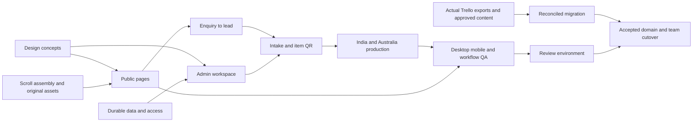

# Darzi implementation tracker

Updated 9 October 2026. Owner: Om + Codex. This is the live delivery checklist for a completely new website and operations platform. Implementation checks refer to existing code/assets; verification checks refer only to the stated tested scope. Unchecked items need a further check, implementation or external input. Invoice preparation remains excluded. Consolidated evidence and limits are recorded in `design/QA.md`.

## 01 — Foundation
- [x] Review the original brief and distinguish it from the current instructions.
- [x] Visit supplied website references and attempt both Trello invitations.
- [x] Extract Australia and India production stages from the screenshots.
- [x] Document the public sitemap, roles, workflows and replacement strategy.
- [x] Create isolated working branch `codex/darzi-platform`.
- [x] Assign parallel backend, admin and media work.
- [x] Scaffold the full Next.js / TypeScript application.
- [x] Define common typography, colour, spacing and motion tokens.
- [x] Create structured public-content modules and typed API contracts.
- [x] Add safe environment handling and development/production separation.
- [x] Add start, production build, typecheck and meaningful integration checks.
- [x] Write local running instructions and production setup requirements.

## 02 — Art direction and original media
- [x] Generate a complete, readable homepage hero concept.
- [x] Generate downstream editorial-work and craft section concepts.
- [x] Generate the consultation/service template concept.
- [x] Generate desktop admin and mobile item-action concepts.
- [x] Extract a consistent design system before frontend implementation.
- [x] Create original charcoal suit hero poster with left negative space.
- [x] Create original tailoring / textile / finished garment imagery.
- [x] Preserve all original prompts and selected asset paths.
- [x] Inspect HeyGen generation capabilities for a genuine assembly film.
- [x] Create seven matching original illustrated assembly frames at 1920 × 1080, totaling 593,640 bytes as WebP.
- [x] Inspect the fixed camera, lighting, suit placement and final still across the seven frames.
- [x] Encode WebP posters/editorial images and archive PNG masters outside the served folder.
- [ ] Generate and inspect a continuous assembly film if a suitable creation workflow becomes available; no HeyGen video was generated.
- [ ] Create/inspect a mobile film variant and WebM/MP4 exports if continuous film production proceeds.
- [x] Record media provenance and distinguish concept imagery from approved client work.

## 03 — Public shell and homepage
- [x] Implement responsive brand header and services dropdown.
- [x] Implement mobile navigation disclosure, accessible names and focus handling; full keyboard audit remains pending.
- [x] Implement immediate hero poster and live HTML heading/CTA.
- [x] Implement scroll-driven assembly keyframes, reverse scrubbing and static fallback states (no player controls).
- [x] Honour reduced motion and data saving; draw frames only while scroll progress changes.
- [x] Create material statement with editorial typography.
- [x] Create asymmetric selected-work compositions and detail links.
- [x] Create native-scroll craft chapters and desktop sticky media stage.
- [x] Provide stacked mobile craft chapters and static motion fallback.
- [x] Create clear service links and accessible fabric/category filters.
- [x] Create textile teaser and contact/studio finale.
- [x] Create coherent footer and useful policy/admin links.
- [x] Reserve media dimensions and lazy-load below-fold assets.
- [x] Implement an original shared SVG/CSS stitching loader for page/workspace/hero waits and compact busy controls, with static reduced-motion styling and no remote animation/player dependency. Research references: [Needle and Thread](https://lottiefiles.com/free-animation/needle-and-thread-wiAt0m2tOi), [Sewing Triptych](https://codepen.io/karomancer/pen/yLNdeXE), [Spline Viewer](https://docs.spline.design/exporting-your-scene/web/exporting-as-spline-viewer); no third-party asset/code was copied.

## 04 — Every public page
- [x] Bespoke commission page, process, FAQ and contextual enquiry.
- [x] Made-to-measure page, service explanation and FAQ.
- [x] Alterations page, assessment journey and contextual enquiry.
- [x] Weddings page, event date/party-size enquiry context.
- [x] Our craft page with honest process story.
- [x] Fabric selection page with accessible family filters.
- [x] Our work page with category filters and empty state.
- [x] Work detail template with garment specifications and related enquiry.
- [x] World of Darzi / house page.
- [x] Contact / consultation page and studio directions.
- [x] Draft privacy, terms and cancellation destinations, flagged for business approval.
- [x] Thoughtful 404 and route loading/error states.
- [x] Preserve or map existing important public URLs.
- [x] Add accurate title/description metadata and sitemap/robots.
- [x] Prevent demo/generated work from being represented as verified client work.

## 05 — Consultation and leads
- [x] Validate name, desired service and one reachable contact channel.
- [x] Support occasion date, party size, message and contact preference.
- [x] Preselect service from incoming page links.
- [x] Save enquiries to durable Leads records.
- [x] Make duplicate submission idempotent.
- [x] Preserve form input on failures and show retry/error feedback.
- [x] Show acknowledgement without claiming an appointment is booked.
- [x] List and search leads in admin.
- [x] Preserve the original enquiry alongside attributed, dated follow-up notes and lead status actions.
- [x] Convert a lead into intake without re-entering customer details.
- [x] Keep the converted enquiry linked to its commission and prevent reverting converted status.

## 06 — Identity, access and persistence
- [x] Create a new Neon project and separate development branch.
- [x] Provision database schema without modifying existing business records.
- [x] Integrate Neon-compatible Postgres persistence.
- [x] Configure managed Neon authentication and a private development storage bucket.
- [x] Provision separate production Managed Better Auth and the private `darzi-private-jobs` bucket; keep production connection/Auth/storage secrets in ignored mode-0600 configuration.
- [x] Guard development demo seeding against production/wrong branch/host and missing demo opt-in.
- [x] Apply guarded `database/setup-production.ts` schema/settings-only bootstrap; independently confirm 18 application tables, settings=1 and all other application rows=0, with no managed users/accounts/sessions at bootstrap.
- [x] Provide durable local development persistence when Neon is unavailable.
- [x] Enforce server-side authenticated sessions.
- [x] Implement Super Admin, Australia Admin and India Admin presets.
- [x] Remove customer-contact fields from India responses.
- [x] Check permissions on direct item/QR/API access.
- [x] Implement sign-in, sign-out and expired-session return destinations.
- [ ] Provide account recovery with a configured mail/auth provider.
- [x] Make production mode fail closed without configured authentication/database.
- [x] Keep secrets out of tracked files and tool outputs.

## 07 — Rapid intake and customers
- [x] Find/reuse an existing customer and avoid obvious duplicate entries.
- [x] Create a new customer with reachable contact information.
- [x] Group intake into customer, garments, measurements and deadline/review.
- [x] Add/remove garment rows and specify quantities for independently tracked pieces.
- [x] Generate separate item IDs for independently moving quantities.
- [x] Save and resume incomplete drafts.
- [x] Validate dispatch prerequisites beside relevant fields.
- [x] Dispatch completed specifications into India's acceptance queue.
- [x] Record fabric references, design details, notes and attachments.
- [x] Preserve explicit measurement units and authoritative source versions.
- [x] Choose accepted non-draft garment history for the selected customer; copy numeric values/source sheet as an editable snapshot with provenance.
- [x] Browser-verify measurement copy/edit and test that edits leave the original accepted revision intact.
- [x] Show customer history and linked orders.

## 08 — Production and order detail
- [x] Implement shared order/item model and aggregate order progress.
- [x] Implement searchable/filterable order table.
- [x] Implement India production board with optional outside work.
- [x] Derive Australia's production/transit columns from shared item records.
- [x] Implement board/table alternative and mobile cards.
- [x] Implement item detail, stage actions and chronological history.
- [x] Require a reason/owner for holds while retaining the underlying stage.
- [x] Provide hold-resolution reason entry and retain the underlying stage/history.
- [x] Provide QC pass/fail, a rework reason and selectable rework target.
- [x] Block affected production on unaccepted post-dispatch revisions.
- [x] Distinguish physical Australia receipt from India acceptance.
- [x] Record trial readiness, local/India alterations, pickup and completion.
- [x] Support partial readiness and per-item shipment/pickup.
- [x] Store carrier, tracking, arrival estimate and shipment item membership.
- [x] Provide Super Admin stage correction/reopening with a reason and activity entry.
- [x] Keep mobile secondary item actions inline while retaining the primary next-step action.
- [x] Reject stale garment-version updates and stale appointment time/status snapshots.
- [x] Preserve intake drafts and clear retry state after failed requests (browser checks are recorded separately).

## 09 — QR, labels and files
- [x] Generate opaque QR links without client data.
- [x] Keep login return paths tied to the scanned item with bounded internal-route validation.
- [x] Wait for fresh authorized destination data and offer refresh retry instead of a false missing-item state; ignore late prior-route state responses.
- [x] Provide camera QR scanning, ZXing fallback and permission recovery (real-device camera check remains a launch task).
- [x] Provide printed number/token/item-ID lookup and current/canonical-site garment-link validation with invalid-code feedback.
- [x] Add existing-garment/customer/order search, explicit multi-selection and copies-per-garment preview on Scan.
- [x] Issue permanent print labels only after dispatch to India; block draft/unsent rows and provide intake/dispatch destinations.
- [x] Limit jobs to 50 distinct garments and 1–10 copies; deduplicate selections and reject the entire job for missing/inaccessible/unissued records.
- [x] Allow completed garments to be included for replacement labels; retain the saved token without changing stage.
- [x] Use `NEXT_PUBLIC_SITE_URL` as the canonical QR origin and show a localhost-label notice.
- [ ] Configure and verify the final public HTTPS `NEXT_PUBLIC_SITE_URL` before issuing phone/workshop labels.
- [x] Keep the routine next-stage control visible in the item inspector/mobile action area.
- [x] Implement Scan next and clear save acknowledgement.
- [x] Render explicit label previews with generation retry, configured stock dimensions and zero-margin print pages; Print opens the system dialog.
- [x] Verify rendered-label URL → anonymous sign-in → exact garment return, authenticated printed-ID lookup, mobile stage update/reload and sheet revision controls in the latest production build.
- [x] Verify 390px/1600px label selection/copies and preview, foreign-link feedback, empty-job blocking, no horizontal document overflow and no captured app console errors in that flow.
- [ ] Verify physical output at 100% scale on the actual printer/stock; opening the print dialog does not establish a printed label.
- [x] Reprint labels without changing item identity.
- [x] Upload and view private job attachments with authorization.
- [x] Validate file types/size and preserve source metadata.
- [x] Keep public portfolio assets separate from private files.

## 10 — Team and business operations
- [x] Super Admin can create/disable staff access and assign fixed presets.
- [x] Australia/India access is visibly reflected in navigation and API responses.
- [x] Add appointment calendar/list and creation/status actions.
- [x] Implement dedicated appointment rescheduling with overlap checks and studio/device timezone conversion.
- [x] Preserve unchanged appointment instants; require explicit earlier/later selection for edited repeated clock-change times.
- [x] Test stale rescheduling and rejection of cancelled/completed appointment reactivation.
- [x] Keep public enquiries separate from confirmed appointment bookings.
- [x] Add appointment completion/cancellation states.
- [x] Add staff attendance check-in/check-out and daily history.
- [x] Add revenue summary from actual recorded financial amounts.
- [x] Provide operational reporting without invented financial figures.
- [ ] Configure outgoing appointment email/reminder provider before real sending.
- [ ] Integrate Stripe only when approved business/payment configuration is supplied.

## 11 — Legacy replacement and launch
- [x] Build Trello JSON export import preview and mapping review.
- [x] Preserve legacy source IDs, authors, timestamps and attachments metadata.
- [x] Implement import of completed history into a read-only Legacy archive; verified with synthetic exports only.
- [ ] Reconcile active cards across boards using verified source relationships.
- [ ] Copy accessible source attachments into independent durable storage.
- [ ] Count/reconcile actual imported records against accessible exports.
- [ ] Rehearse a final freeze/delta import before team cutover.
- [ ] Verify real label printing/scanning with both teams.
- [ ] Obtain approved brand assets, photographs, testimonials and factual copy.
- [ ] Obtain authoritative measurement templates and label dimensions.
- [x] Provision the new Neon project, separate development/production Auth and private storage; production has schema/business settings without demo or customer records.
- [ ] Set up real staff managed-auth accounts, invitations/recovery and outgoing mail configuration.
- [ ] Obtain Trello exports/access and Squarespace/domain/hosting access.
- [ ] Deploy to a review environment and run a complete smoke check.
- [ ] Confirm domain switch only after the concrete build/import is reviewed.
- [ ] Retire Trello/Squarespace only after accepted migration and recovery checks.

## 12 — Verification and finishing
- [x] Run typecheck and the latest production build.
- [x] Pass 11 bootstrap guard rejection checks without database connections; verify both production pooled/direct connections with read-only queries.
- [x] Retain the earlier 19 backend and 13 appointment/time passing checks (32 total); these suites were not rerun during the latest QR pass.
- [x] Pass 7 QR generation/unit checks, including independent decoding of generated PNGs and batch/selection/origin validation.
- [x] Pass 7 Node-reported protected QR-flow checks, including the parent test: anonymous rejection, exact token/ID/number resolution, AU/India access, contact restrictions, invalid labels and unchanged stage/identity.
- [x] Verify enquiry → Lead → intake → independent item workflow.
- [x] Verify India acceptance → QC → shipment → Australia receipt → pickup.
- [x] Verify hold, revision, duplicate and concurrency recovery.
- [x] Verify sign-in/QR return, AU/India contact restrictions and anonymous API rejection.
- [x] Verify committed workflow records through an independent Postgres connection.
- [x] After a dev stop/build/production start, reopen the saved measurement-copy garment and verify 101cm plus provenance; independently confirm the source remains 98cm. Lead follow-up and managed sign-in also persist.
- [ ] Verify all navigation/actions and gallery/FAQ/form states.
- [x] Inspect selected public/admin desktop and mobile flows; retain named screenshots in `design/QA.md`.
- [x] Verify final desktop workspace width equals the 1600px viewport and mobile item/login width equals the 390px viewport; inspect inline mobile secondary actions and a saved attributed note.
- [ ] Complete route/state coverage across 360–430px sizes and supported browsers.
- [ ] Inspect reduced-motion/no-video/loading/error states.
- [ ] Check keyboard/focus, contrast and 44px touch targets.
- [x] Compare accepted admin concepts and browser screenshots using `view_image`.
- [x] Record palette, typography, layout, card, inspector, mobile and navigation comparisons in `design/ADMIN_FIDELITY_QA.md`.
- [x] Pair-review the public opening hero and concept for copy/navigation, and the final desktop admin board with its concept.
- [ ] Finish the public concept/copy/navigation fidelity pass across all templates.
- [x] Measure local media bytes: the seven-frame hero sequence totals 593,640 bytes.
- [ ] Measure loading/animation performance in a reproducible mobile lab run.
- [x] Record external dependencies and separate implemented features from unverified launch checks.

## Delivery dependency map

## Current external inputs

- New Neon project `darzi-platform` (`icy-grass-38018123`) is provisioned in Singapore. Local development remains isolated. Production branch `br-frosty-recipe-b39v7qnl` has its own Auth/private bucket and schema/settings only; private owner activation, mail configuration, confirmed hosted origin and deployment smoke checks remain required. Explicit schema maintenance command: `DARZI_SETUP_PRODUCTION=true node --env-file=.darzi/production.env --import tsx database/setup-production.ts`; never run it as part of a build.
- Source Trello exports/account access are required for actual migration. Invitation screenshots are context only.
- Approved photographs/testimonials and policy copy are needed before public launch.
- HeyGen general scene creation is not exposed by this session’s plugin tools. No new video was generated. The current scroll experience uses seven original matching WebP keyframes; continuous film production still needs a suitable generation workflow and continuity review.

## Verified development evidence

- The latest QR pass has 7 generation/unit checks and 7 Node-reported protected-flow checks passing. It independently decodes generated PNGs and verifies read-only QR resolution/permissions. The earlier 19 backend and 13 appointment/time checks remain historical passing results (32 total), not suites rerun in this QR pass. Typecheck and the latest `npm run build` passed on 9 October 2026. Earlier independent Postgres reads confirmed committed workflow data; managed sign-out cleared provider cookies and the next protected request returned 401.
- Scan now prepares explicit existing-garment batches after dispatch, with up to 50 pieces and 10 copies each. Reprints preserve opaque identity and stage; invalid or unavailable selections fail closed. Canonical public-origin configuration, physical camera/printed scanning and actual label output remain launch checks. The browser Print action opened a system dialog, with no physical print verified.
- Synthetic public browser enquiry saved contact preference, party size and event date, then was converted into a discoverable draft. No outgoing message was sent.
- Accepted 98cm source measurements were copied, edited to 101cm and saved in synthetic draft `DZ-2026-1045`; the new garment reopened with 101cm and provenance after process restart. Independent database inspection confirmed the original remains 98cm. Lead follow-up and authentication also survived the fresh process.
- Synthetic appointment rescheduling was saved/reloaded and cancelled after QA. The final 1100 × 800 modal inspection shows explicit Earlier GMT+11 selection; automated checks cover both occurrences and unchanged instants. Mobile note saving succeeded and shows actor/date, with secondary actions inline above the fixed primary controls. Exact screenshots are listed in `design/QA.md`.
- Production bootstrap created only schema/business settings; independent reads confirmed no application records outside settings or managed auth users/accounts/sessions at that point. No actual legacy card/file import, hosted deployment acceptance or live domain change has occurred.
